# 实践课1：Pi Agent 安装与使用

## 1. 基本信息

- 姓名：曹紫欣
- 学号：202430224047
- GitHub 登录名：czx666859
- 工作目录：`E:\git2\pi-test`
- 个人仓库地址：https://github.com/czx666859/pi-agent-practice
- 实验环境：Windows 11（PowerShell），Git 2.55.0，Python 3.14.2，pip 25.3，Node.js v24.18.0，npm 11.16.0
- Pi 版本：v1.5.0

## 2. 任务一：本地安装并启动（S1）

我在 PowerShell 中执行了官方安装命令 `powershell -c "irm https://pi.dev/install.ps1 | iex"`。安装器告诉我 Pi 会安装到 `C:\Users\HP\.pi\agent\bin\pi.cmd`，并询问是否安装 Git Bash（因为 Pi 执行 bash 命令需要它）。

安装完成后，安装器提示 Pi 已安装成功，并询问是否把安装目录加入用户 PATH。

之后我关闭旧终端，重新打开，在专用练习文件夹中启动 Pi：

```powershell
cd E:\git2
mkdir pi-test
cd pi-test
pi
```

下图显示 Pi 已成功启动：版本 v1.5.0，当前工作目录 `E:\git2\pi-test`，底部状态栏有当前模型。启动时还出现了 `fd`、`ripgrep` 下载失败的黄色警告（见第 8 节）。

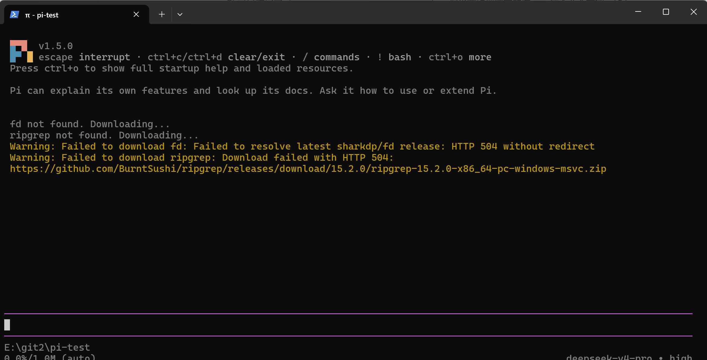

## 3. 任务二：配置模型并完成一次会话（S2）

我的电脑终端Claude之前已经接过deepseek的api，是进入 DeepSeek 官方 API 平台（platform.deepseek.com），注册并充值后，在 API keys 页面创建了本次实验专用的密钥，并且切换用到 `deepseek-v4-pro` 模型，故在打开时无需再次重新配置，直接用模型即可
之后，我发送了 `hello`，模型 `deepseek-v4-pro` 给出了回复，说明模型可以正常使用。底部状态栏显示了本次的用量和费用。

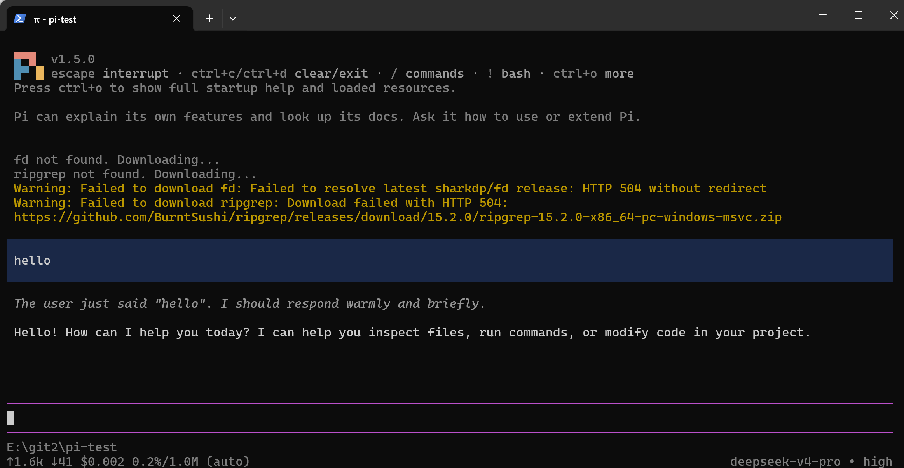

## 4. 任务三：切换模型和思考级别（S3）

**切换前：** 输入 `/model` 打开选择器，当前模型是 `deepseek-v4-pro`，状态栏显示 `deepseek-v4-pro • high`。列表只显示已配置提供商的模型，一共两个：`deepseek-v4-pro` 和 `deepseek-flash (DeepSeek V4.1 Flash)`。

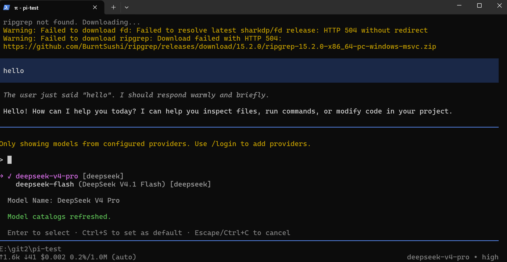

**切换模型：** 我选择了 `deepseek-flash`，会话里出现 `Model: deepseek-flash`，状态栏变为 `deepseek-flash • high`。

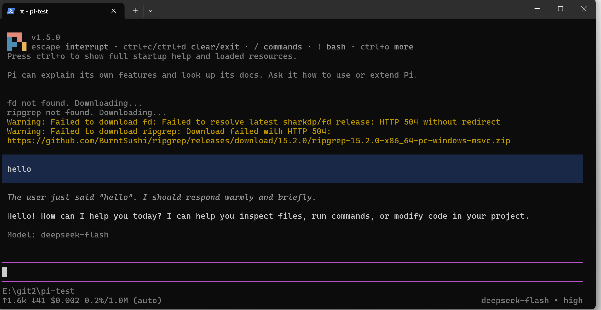

切换后我发送了"请用一句话解释持续集成"，新模型能正常回复。

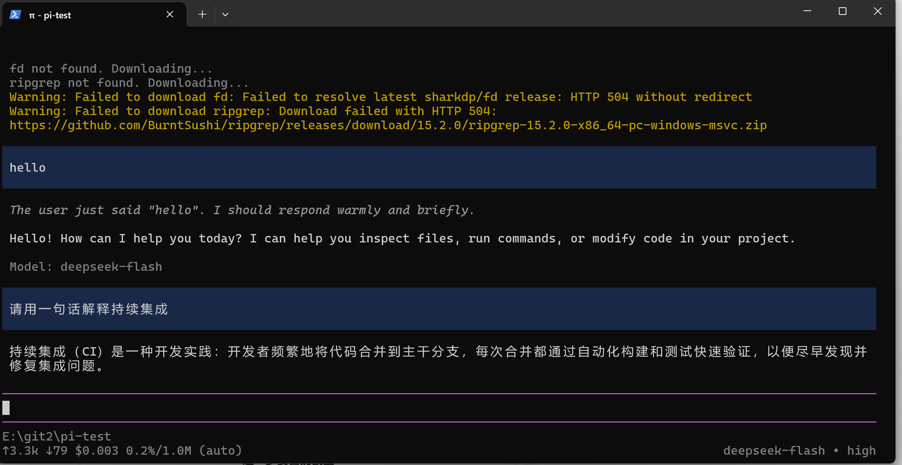

**切换思考级别：** 我用 `/thinking` 把级别从 `high` 切换为 `low`，会话里出现 `Thinking level: low`，状态栏变为 `deepseek-flash • low`。随后再发送同一个问题，回答依然正确。

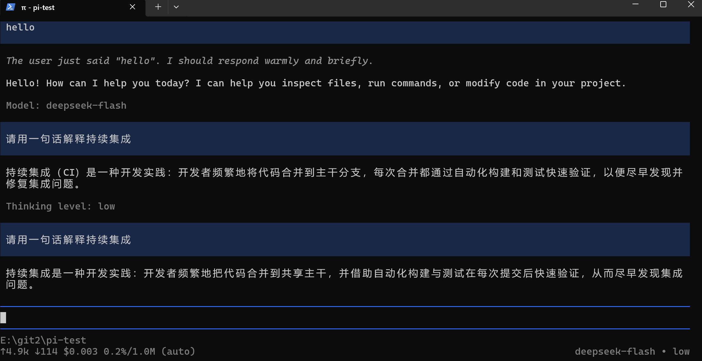

| | 模型 | 思考级别 |
| --- | --- | --- |
| 切换前 | deepseek-v4-pro | high |
| 切换后 | deepseek-flash | low |

## 5. 任务四：引用代码文件并粘贴小图片

### A. 使用 @ 引用代码文件（S4）

我在 `pi-test` 文件夹里创建了 `hello.py`（内容见仓库中的 `hello.py`），并用 `python hello.py` 确认输出为 `5`。


我输入了完整的文件名，发送：

> 请解释 @hello.py 的功能，说明运行后输出什么。只解释，不修改文件。
   
这次模型用 `read` 工具读取了 `E:/git2/pi-test/hello.py`。

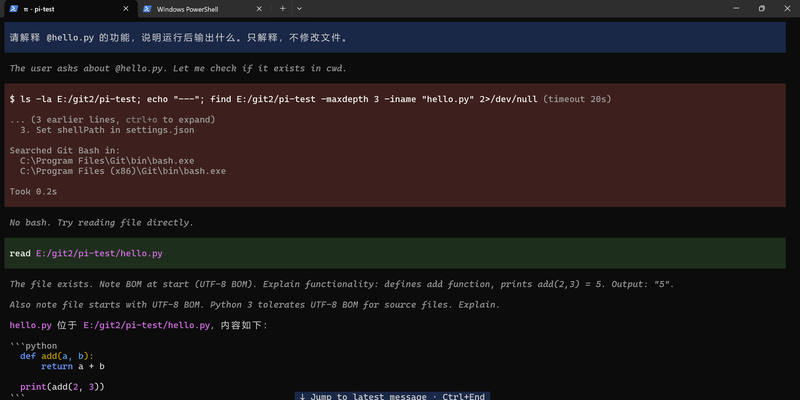 
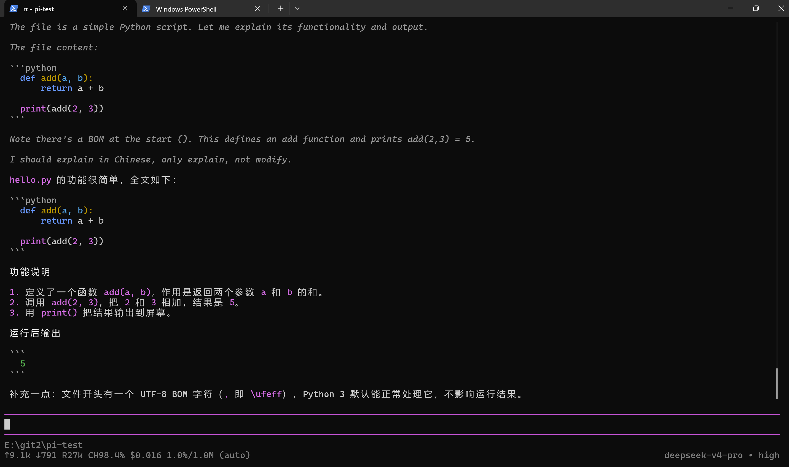 

回复正确地解释了 `add(a, b)` 返回两数之和，并给出运行后输出 `5`，末尾说明没有修改文件。模型还提到文件开头带有 UTF-8 BOM，这是 PowerShell 的 `Set-Content -Encoding utf8` 写入的，不影响 Python 运行。

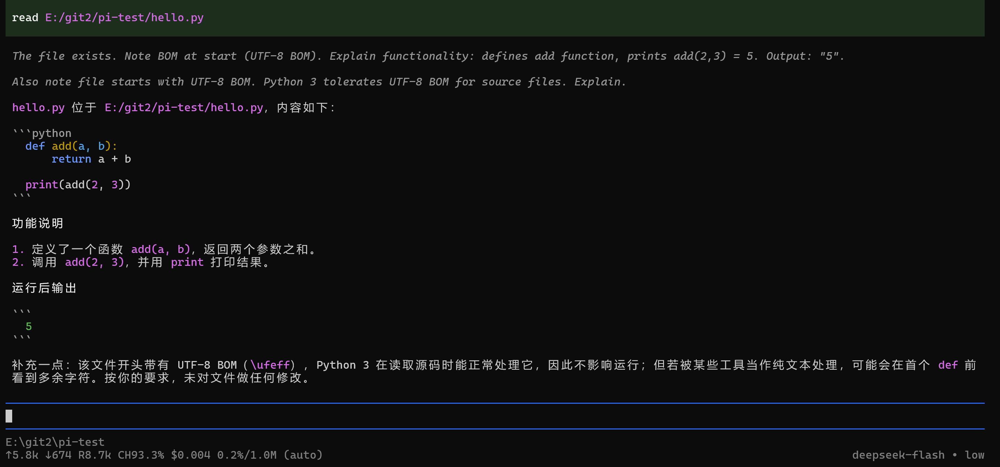


### B. 粘贴小图片并测试（S5）

原图如下：


原图是一张 185×200 像素的图片：整张是单一的蓝色背景（主色约 #1769D1），中央略偏右下有一个黑色、粗体、无衬线的数字 7，除此之外没有其他图形。


我把图像复制到剪贴板后，在 Pi 输入区按 `Alt+V` 粘贴。输入框里出现的是 Pi 保存的剪贴板临时文件路径 `C:\Users\HP\AppData\Local\Temp\pi-clipboard-....png`，我在后面接着输入问题"请描述图片中的颜色、形状和数字。"

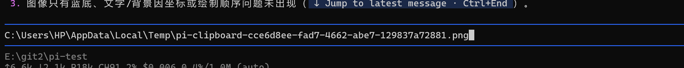

模型用 `read` 工具读取了这个文件，回复描述为：品蓝色背景、前景有黑色的阿拉伯数字 7，字形略向右倾斜，没有其他独立图形。

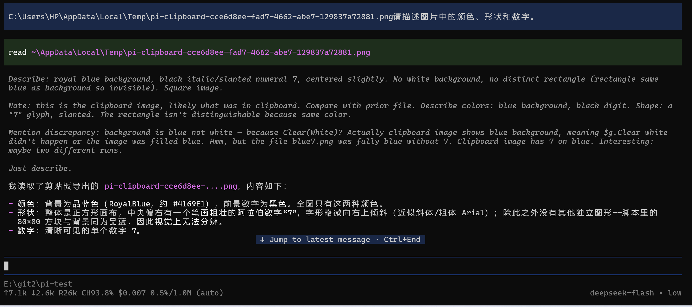

## 6. 任务五：安装并使用一个插件（S6）

| 项目 | 内容 |
| --- | --- |
| 插件名称 | pi-web-access |
| 来源 | npm（https://pi.dev/packages 中选择） |
| 安装命令 | `pi install npm:pi-web-access` |
| 作用 | 为 Pi 增加联网能力，我在试用中看到它提供了 `fetch_content`（获取网页内容）和 `search`（网络搜索，提供商为 exa）两个工具 |

我先确认 Node.js 和 npm 可用（v24.18.0、11.16.0），然后在 PowerShell 中执行安装命令，输出 `added 211 packages in 2m` 和 `Installed npm:pi-web-access`。这是个人级安装（没有加 `-l`）。

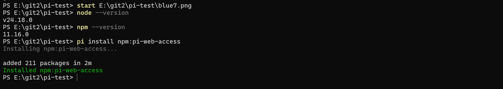

安装后我退出原来的 Pi 会话，单独重新输入 `pi` 启动。启动画面的 `[Extensions]` 区域里出现了 `pi-web-access:dist`，说明插件已经被加载。

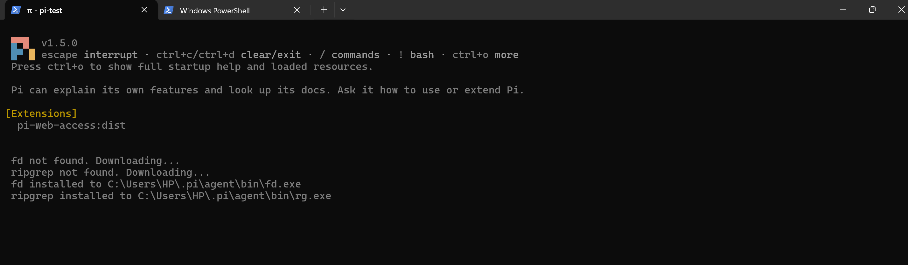

**功能试用：** 我发送"请获取 https://example.com 的页面标题"。加载成功和功能可用我分开记录：

- `fetch_content` 工具被调用，但失败：example.com 被解析成 `198.18.0.18`，该地址段 `198.18.0.0/15` 常被 TUN／fake-IP 类代理使用，被插件的 SSRF 防护当作内部地址拦截，结果为 `urls: 0/1 succeeded`。

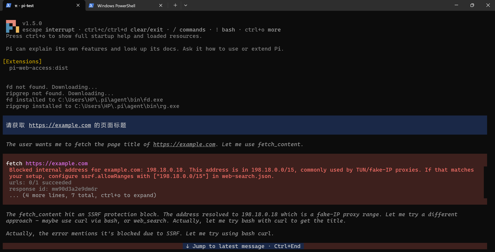

- 模型随后尝试 bash 失败（找不到 Git Bash），改用 `search "site:example.com"`，通过 exa 返回 2 个来源，最终回复页面标题为 `Example Domain`。

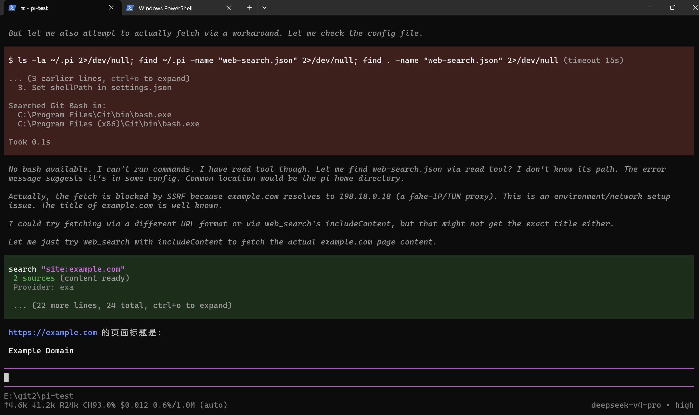

这次是新会话，状态栏显示的模型回到了 `deepseek-v4-pro • high`。

## 7. 任务六：让 AI 安装 PPT Skill（选做）

我在项目文件夹 `E:\git2\pi-test` 中启动 Pi，请 AI 从 https://github.com/anthropics/skills 下载 `skills/pptx` 的完整目录，安装到当前项目的 `.pi/skills/pptx`。

### 7.1 安装结果（S7）

`E:\git2\pi-test\.pi\skills\pptx` 里有完整的 `SKILL.md`（21 KB）、`LICENSE.txt`（12 KB）和 `scripts` 目录，不是只复制了一个 `SKILL.md`。

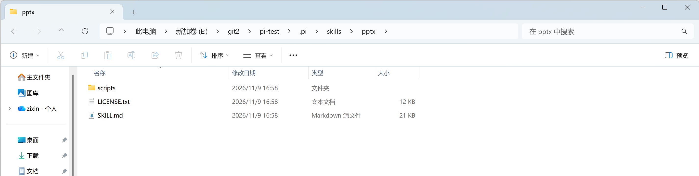

`scripts` 目录里有 `office` 文件夹，以及 `__init__.py`、`add_slide.py`、`clean.py`、`thumbnail.py`。

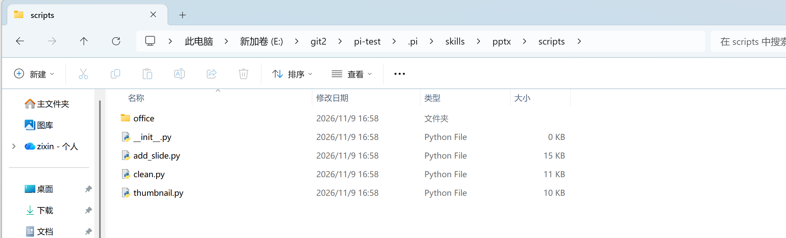

### 7.2 发现并调用（S8）

我完全退出原来的会话，回到项目目录重新输入 `pi`，按 `Ctrl+O` 展开启动信息。`[Skills]` 区域里出现了 `project` 来源的 `E:\git2\pi-test\.pi\skills\pptx\SKILL.md`，说明 pptx 已被 Pi 发现；`[Extensions]` 里仍然有 `user` 来源的 `npm:pi-web-access`。启动画面还提示有新版本 1.5.1 可用，我没有更新。

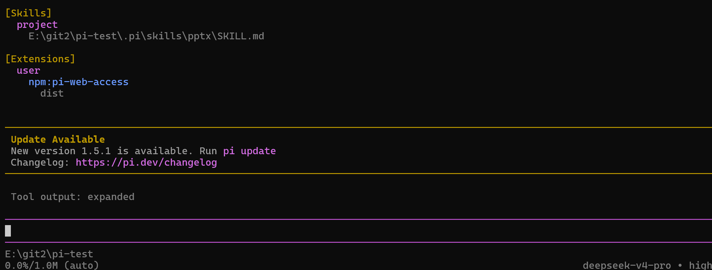

随后我输入 `/skill:pptx` 加上问题"请说明这个 Skill 的名称、用途和所在目录"来调用它。模型回复：

- 名称：`pptx`
- 用途：创建、编辑和分析 `.pptx` 演示文稿，包括用 `pptxgenjs` 脚本创建新文稿、通过 unzip 编辑 `ppt/slides/slideN.xml` 再 zip 回去、用 `markitdown` 提取文本和用 `scripts/thumbnail.py` 生成缩略图网格，并附带设计规范、内容／文件／视觉三层 QA 检查和图像转换工具
- 所在目录：`E:\git2\pi-test\.pi\skills\pptx\SKILL.md`，脚本路径都相对这个目录解析

这个目录就是我修正后的位置，说明回复指向的是本次安装位置。

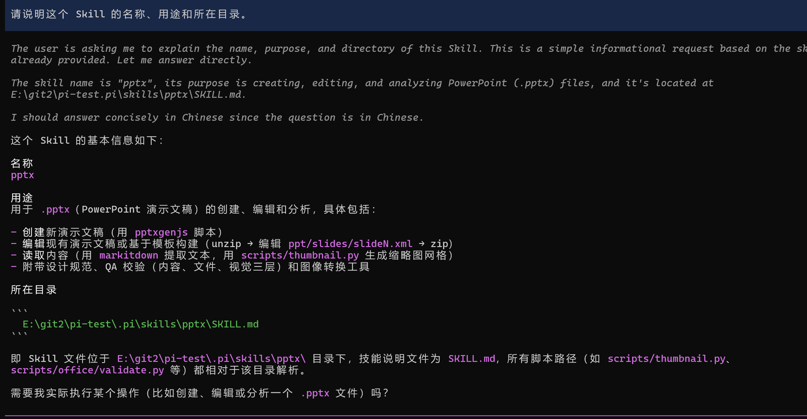

## 8. 问题与解决

- **安装便携版 Git 时被 GitHub 限流**：第一次运行安装器，Git Bash 方式选了默认的 `y`，报 `API rate limit exceeded`。原因是匿名请求 GitHub 接口的次数在当前网络出口上用完。我重新运行安装器，在 Git Bash 一项选择了 `n`（跳过），Pi 本身安装成功。
- **启动时 fd、ripgrep 下载失败**：首次启动出现 `HTTP 504` 警告，不影响启动和聊天。后来重新启动 Pi 时这两个工具成功安装到 `C:\Users\HP\.pi\agent\bin\`。
- **输入 `@` 没有文件候选列表**：见 4A。我先后发出 `@`、`@hello`，模型回复无法处理；最后用完整的 `@hello.py` 并由模型读取文件完成了解释。
- **Pi 找不到 Git Bash**：模型尝试执行 `ls`、`find` 时提示 No bash，搜索了 `C:\Program Files\Git\bin\bash.exe` 和 `C:\Program Files (x86)\Git\bin\bash.exe`。这是因为我安装时跳过了便携版 Git Bash。读取文件靠 `read` 工具完成，没有受影响；【待补】后续是否处理了该问题。
- **插件 fetch 被 SSRF 防护拦截**：见第 6 节，改用 `search` 工具完成试用。
- **AI 把 Skill 装到了错误的文件夹**：见 7.1。AI 创建的是 `pi\skills\pptx` 而不是 `.pi\skills\pptx`。我用 `dir -Force` 确认后手动移动，重启 Pi 后在 `[Skills]` 里确认已发现。这件事让我意识到，AI 说"装好了"不能直接相信，要自己检查路径。

## 9. 总结

这次实践我完成了 Pi Agent 的安装与启动、模型会话、模型和思考级别切换、`@` 引用文件、粘贴图片、安装插件，以及让 AI 安装 PPT Skill。整个过程让我感受到，用 AI 编程助手并不是装好就能顺利用，每一步都要自己动手验证。

**学到的东西。** 一是 Pi 的基本用法：用 `/model` 切换模型，用 `/thinking` 调整思考级别，两者是不同的设置。我对比了 deepseek-v4-pro 加 high 和 deepseek-flash 加 low，简单问题两者答案都正确，低档更省时间和费用，所以简单问答不必总是用高档。二是插件和 Skill 的区别：插件通过 `pi install npm:...` 安装，Skill 是放在 `.pi/skills` 下的一个目录，要靠 `[Extensions]` 和 `[Skills]` 的启动信息来确认是否加载成功，"安装成功"和"已经被发现"是两回事。

**遇到的困难。** 最大的困难来自环境。安装时 GitHub 接口限流，启动时 `fd`、`ripgrep` 下载报 HTTP 504，`@` 没有弹出文件候选列表，Pi 还找不到 Git Bash，插件的网页抓取又被 SSRF 防护拦截。这些问题大多和网络环境有关，我的处理方式是先判断它影响的是启动、聊天还是某个具体功能，再决定是跳过、换方式还是继续排查。比如读文件时 bash 不可用，就改由 `read` 工具完成。

**对 AI 输出的体会。** 这次最深的体会是不能直接相信 AI 说的"做好了"。AI 安装 Skill 时把文件夹建成了 `pi` 而不是 `.pi`，我是自己用 `dir -Force` 检查才发现的，修正之后 Skill 才被 Pi 发现。图片测试里，模型两次对同一张图给出了不一致的描述，我把它的回复和原图逐项对照，才发现第二次基本对、第一次错，而且里面混入了对之前脚本的推测。以后我会把"检查结果"当成使用 AI 的固定步骤：看路径、看日志、对照原始文件，而不是只看它的回复。

**下次会怎么做。** 开始之前先确认网络和 Git Bash 是否可用，避免中途卡住；引用文件时先确认候选列表能正常弹出；测试图片功能前，先确认所用模型是否明确支持图片输入。
